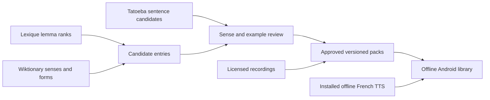

# French learning content: source research

Researched 11 November 2026 against primary sources. Scope: personal-use, offline Android app; a B2 learner; an expandable library initially targeting 20,000 lemmas plus expressions. This is a source-selection proposal, not an implemented importer or a measured coverage audit. The repository had no existing research-note convention, so this note establishes `docs/research/`.

## Recommendation

Use **Lexique 3.83 for the initial frequency backbone**, **English and French Wiktionary extracts through Kaikki/Wiktextract for dictionary candidates**, **Tatoeba for short example candidates**, and **licensed Wikimedia pronunciation recordings where available, backed by an installed offline Android French TTS voice**. Prepare packs on a development computer; the phone receives compact, reviewed data and media rather than processing raw corpora.

The limiting resource is not finding 20,000 strings. It is producing correct, useful **sense-specific cards** with aligned English meaning, understandable French definition, unambiguous context and suitable audio. No reviewed primary source promises that complete combination. Keep a broad searchable candidate library separate from material approved for study. The user should not have to author the core content.

## Sources and decisions

| Component | Verified facts and access | Decision |
| --- | --- | --- |
| Frequency and morphology | Lexique 3.83 provides roughly 140,000 French word forms with lemmas, grammatical categories, gender, number, phonemic information, and separate book/subtitle frequencies. Its publisher offers a ZIP and identifies the license as CC BY-SA 4.0 (the label has a typographic error). [Publisher](https://openlexicon.fr/datasets-info/Lexique383/README-Lexique.html) | Best initial backbone: the two frequency channels match our intended blend without collecting raw subtitles. The published form count is **not** a lemma count. |
| Lemma ranking | The Lexique manual identifies `freqlemfilms` and `freqlemlivres` as lemma frequencies per million occurrences; word-form frequencies are separate. [Manual, organization of the database](https://openlexicon.fr/datasets-info/Lexique383/Manuel_Lexique.3.pdf) | Deduplicate lemma/part-of-speech records; do not sum an already aggregated lemma frequency once for every inflected row. Retain form mappings for lookup and cloze construction. |
| Conversational weighting | The authors evaluated a 52-million-word French subtitle corpus as an approximation of language in human interactions and reported useful predictive validity. This is evidence for subtitle frequency, not proof of an optimal learning order. [Original study and author-hosted abstract](https://biblio.ugent.be/publication/599589) | Proposed starting heuristic: normalized subtitle/book rank blend, weighted 70/30 toward subtitles, then bounded topic boosts. The ratio is a product hypothesis, not a scientifically established optimum. Subtitles are a proxy for conversation. |
| English meanings | Kaikki's French-language section extracted from **English Wiktionary** lists 391,323 distinct word forms in its current snapshot; the page's 565.5 MB postprocessed download is deprecated in favor of raw extracts. [French dictionary page](https://kaikki.org/dictionary/French/index.html) | Source English gloss candidates for French entries. Filter proper names, pure inflections, obsolete material and unsuitable senses. These counts do not establish 20,000 usable learning entries. |
| French definitions | Kaikki separately exposes **French Wiktionary**; its French-language section lists 2,035,521 forms and a deprecated 3.0 GB postprocessed download. [French-edition dictionary](https://kaikki.org/frwiktionary/Fran%C3%A7ais/index.html) | Use it for French definition candidates, not as an automatically aligned translation of the English-edition sense list. Definitions are not guaranteed to be simple learner French. |
| Structured extraction | Wiktextract extracts senses, glosses, forms, pronunciation links and qualifiers; completeness differs by edition. The extractor's software license is MIT, which does **not** replace the dictionary content license. [Extractor documentation](https://github.com/tatuylonen/wiktextract) | Prefer pinned raw snapshots and preserve source identity. Validate fields against the edition's schema; do not assume English-edition fields work unchanged for French. |
| Raw dictionary access | Kaikki publishes regularly updated JSONL; current raw French-edition data is listed at 6.4 GB / 702.5 MB gzip. English-edition raw data contains many languages and English metadata. A separate multilingual pronunciation archive exists. [Raw downloads](https://kaikki.org/dictionary/rawdata.html) | Stream and filter on the build machine. Pin dump date, extraction revision and checksum; do not ship multi-gigabyte raw dictionaries to Android. |
| Examples | Tatoeba offers French/English sentence-pair exports, sentence metadata, translation links and weekly exports. Text defaults to CC BY 2.0 FR; some sentences are CC0. Audio has contributor-specific licenses, and an empty audio-license field explicitly forbids reuse outside Tatoeba. [Downloads and field definitions](https://tatoeba.org/en/downloads) | Use short, directly linked French/English candidates and preserve contributor attribution. Choose an example for the actual sense, not just a matching word. Exclude audio without an explicit usable license. |
| Example quality | Tatoeba's project guidance recommends filtering sentences needing correction or improvement and distinguishes text from audio licensing. [Reuse guide](https://en.wiki.tatoeba.org/articles/show/using-the-tatoeba-corpus) | Treat corpus sentences as candidates. Check naturalness, intended sense, translation, register and contextual independence. Write original examples where needed; do not pretend all corpus material is reviewed learner content. |
| Sentence recordings | Tatoeba's FAQ describes individual audio downloads rather than one current all-language audio ZIP. [FAQ](https://en.wiki.tatoeba.org/articles/show/faq) | Download only selected licensed recordings during pack preparation; use the current audio-ID metadata/download endpoint documented on the downloads page, rather than assuming one recording per sentence. |
| Word recordings | Wikimedia Commons/Lingua Libre is a pronunciation source, but Commons states that each file's description page determines its license. [Project](https://commons.wikimedia.org/wiki/Commons:Lingua_Libre) | Prefer checked France recordings and retain speaker, locale, file URL, license and attribution. Never infer a sound's license from the surrounding dictionary's license. Coverage of our selected entries remains unmeasured. |
| Audio metadata and retrieval | MediaWiki `imageinfo` exposes file URLs, description URLs, hashes and extended metadata; extended metadata is expensive and should be queried in small batches. [API](https://www.mediawiki.org/wiki/API:Imageinfo) Lingua Libre documents category/speaker download methods, but parts of its bulk-dump instructions explicitly date from 2021–2022. [Dataset guide](https://commons.wikimedia.org/wiki/Help:Lingua_Libre/Download_datasets) | Resolve only selected assets, cache metadata, verify the file description and use resumable downloads. Do not make the first pipeline depend on an assumed fresh all-language Lingua Libre archive. |
| Offline speech fallback | Android can enumerate TTS engines/voices, check language availability, speak and synthesize files. Initialization and file synthesis are asynchronous. [TextToSpeech API](https://developer.android.com/reference/android/speech/tts/TextToSpeech) A voice exposes locale and whether it requires a network connection. [Voice API](https://developer.android.com/reference/android/speech/tts/Voice) | Select installed `fr-FR` voices that do not require networking, test in airplane mode, and guide installation if absent. Label synthetic audio. Android's API does not guarantee a particular engine/voice or grant redistribution rights to generated recordings. Keep this fallback local unless the chosen engine's terms permit export. |

## Alternatives investigated

**wordfreq** is a useful optional ranking cross-check: its author combines multiple sources, supports French, and states the frequency data reflects usage through approximately 2021 and is unlikely to be updated again. It is not a ready-made lemma/sense curriculum. [Author README](https://raw.githubusercontent.com/rspeer/wordfreq/master/README.md) Its notice distinguishes Apache-licensed software from CC BY-SA 4.0 data and includes source-specific attribution. [Author licensing notice](https://raw.githubusercontent.com/rspeer/wordfreq/master/NOTICE.md) Recommendation: omit it from the first pipeline unless a sample audit shows clear gains over Lexique.

**Raw OpenSubtitles/OPUS** is unnecessary for the first release: Lexique already provides the subtitle frequency channel we need. The old OpenSubtitles corpus URLs returned 404 during this research; the current [OPUS catalogue](https://opus.nlpl.eu/) uses a different interface. Direct subtitle-content redistribution terms were not established here, so no blanket CC license is claimed. Do not confuse a subtitle downloader's software license with permission to reuse subtitle text. Revisit only if a later corpus-specific license and quality audit justifies it.

**SUBTLEX** is a family of language-specific frequency resources, not one interchangeable multilingual dataset. For our French starting point, use the French subtitle work integrated into Lexique, rather than substituting SUBTLEX-US or another language's norms. [French original study](https://biblio.ugent.be/publication/599589)

## Licensing and provenance

The French Wiktionary license page identifies CC BY-SA 4.0 for current contributions and describes the earlier 3.0 period. [French policy](https://fr.wiktionary.org/wiki/Wiktionnaire:Licence) Wikimedia's governing terms cover reuse, attribution and modifications; retain page links and revision information rather than relying on Kaikki's name alone. [Foundation terms](https://foundation.wikimedia.org/wiki/Policy:Terms_of_Use) English Wiktionary also warns that externally quoted material, including literary example sentences, can carry different terms. [Copyright page](https://en.wiktionary.org/wiki/Wiktionary:Copyrights) Prefer Tatoeba or original examples over indiscriminately copying dictionary quotations.

CC BY-SA permits adaptation and redistribution subject to attribution, license links, change notices and the applicable ShareAlike conditions. [License deed](https://creativecommons.org/licenses/by-sa/4.0/) Personal use is not a reason to discard provenance: packs, backups and Anki exports can later leave the device. Engineering recommendation: keep licensed content and notices separate from application code and study history; preserve attribution inside exports. The exact treatment of a combined adapted content database should be checked before public distribution; this note does not declare that ShareAlike automatically applies to the whole app.

Every sourced component should retain source URL/ID, snapshot/revision, author or contributor credit, license identifier/URL, original text, modification record and retrieval date. Audio additionally needs the file's own license, speaker/locale when available and checksum. Unknown permissions mean an item remains a candidate, not a shipped asset.

## Proposed preparation flow

Follow one entry through this flow: a lemma supplies its rank and forms; dictionary senses supply candidate meanings; the selected example must demonstrate that precise meaning. Only after the English cue, French definition, article/gender, register and audio are checked does that sense become eligible for reading, listening and production cards. A match on spelling alone never approves a card.

Implementation proposal:

1. Build canonical lemma/part-of-speech identities and inflection aliases. Keep expressions as explicit entries. Do not accidentally count conjugations or alternate spellings as new vocabulary; explicitly handle reflexive constructions and gender-dependent meanings.
2. Assign stable internal sense IDs; map English/French edition senses with explicit review decisions. Sense order and wording can change upstream. Neither a shared headword nor a similar gloss is a dependable cross-edition sense ID.
3. Search examples by lemma-aware matching; select short, natural, standalone sentences and remove ambiguous clozes. Reject production prompts admitting several equally plausible answers unless alternatives are explicitly recorded.
4. Keep source definitions as candidates; simplify French wording through checked edits, preserving provenance. Attach France/default and regional/register labels explicitly; missing labels are not evidence of a France recording.
5. Package approved text, indexes, attribution and selected audio into versioned downloadable packs with checksums. Keep learning state outside those packs so corrections do not reset FSRS progress. A missing human recording can use verified local TTS; missing TTS must not silently turn an audio-only test into a blank card.

## Realistic first release and remaining evidence

Suggested milestones are **planning targets**, not measured availability or delivery estimates:

- **Pilot: 200 reviewed senses**, mixing frequent vocabulary, B2-relevant meanings, expressions and difficult edge cases. Validate the three card types and offline audio on the user's device.
- **First useful library: 1,000–2,000 reviewed senses**, spread across rank bands and everyday life/culture/current affairs. Placement should skip familiar material. The broader candidate index can support English/French lookup without presenting all candidates as ready-made study cards.
- **Expansion: 20,000+ approved lemmas over successive packs**, counting senses and expressions separately in coverage reports. Do not advertise this milestone as already fulfilled by dictionary form counts.

Before choosing an exact release size, audit a stratified sample from the candidate 20,000: frequencies present; clean lemma/POS match; noun gender; aligned English/French sense; understandable definition; suitable example and cloze; licensed France audio; verified offline TTS fallback. Report actual pass rates by frequency band and topic. This research did not download full corpora or measure those intersections.

For storage planning only: at an assumed 48 kbit/s and five-second sentence, one recording is about 30 kB before overhead; 20,000 such recordings would be about 600 MB, plus word audio and additional senses. This is arithmetic, not a measured pack size. Text and audio packs should therefore be independently downloadable, and actual codec/duration sizes should be measured in the pilot.

Open evidence gaps: the exact number of eligible unique lemmas; source overlap at B2; how many definitions need rewriting; sense-specific coverage for expressions; regional/audio quality; the target device's offline voice availability; and the chosen TTS engine's export terms. None blocks a small prepared pilot, but all affect the promise of a fully checked 20,000-word library.
